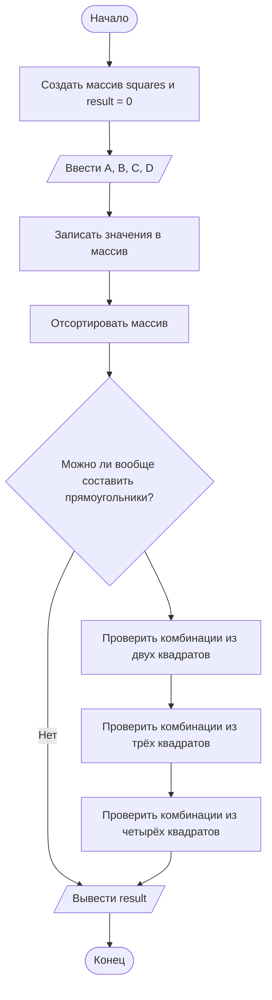

## Отчет по лабораторной работе № 1

#### № группы: `ПМ-2602`

#### Выполнил: `Любимов Артур Викторович`

#### Вариант: `11`

### Содержание

- [Постановка задачи](#1-постановка-задачи)
- [Входные и выходные данные](#2-входные-и-выходные-данные)
- [Выбор структуры данных](#3-выбор-структуры-данных)
- [Алгоритм](#4-алгоритм)
- [Программа](#5-программа)
- [Анализ правильности решения](#6-анализ-правильности-решения)

### 1. Постановка задачи

> На вход программы подаются четыре натуральных числа `A`, `B`, `C`, `D`, обозначающие длины сторон четырёх квадратов. Необходимо определить, сколько прямоугольников можно составить, используя не менее двух квадратов без наложений и зазоров.

Данную задачу можно разделить на 3 подзадачи: нахождение количества прямоугольников из 2, 3 и 4 квадратов.
Для удобства обозначу стороны как a,b,c,d. a - наименьшее, d - наибольшее.

- Сколько прямоугольников можно сложить из двух квадратов:
    1. `a == b` (2 наименьших равны)
    2. `b == c && a != b` (2 вторых по величине равны и не равны первому, вычитаем случай, когда первые три равны)
    3. `c == d && b != c` (2 наибольших равны и не равны второму, вычитаем случай, когда последние три равны)
- Сколько прямоугольников можно сложить из трех квадратов:
    1. `a == b && b == c` (3 первых равны)
    2. `b == c && c == d && a != b` (3 последних равны и не равны первому, вычитаем случай, когда все 4 равны)
    3. 2 наименьших квадрата равны, а их сумма равна ОДНОМУ из наибольших.
    4. 2 вторых по величине квадрата равны, а их сумма равна наибольшему, при этом первый не равен двум вторым(вычитаем случай, когда первые 3 равны).
- Сколько прямоугольников можно сложить из четырех квадратов:
    1. Все 4 квадрата равны.
    2. Наименьшие три равны между собой, а их сумма равна четвертому.

Всего надо рассмотреть `3 + 4 + 2 = 9` случаев, то есть больше 9-ти прямоугольников получиться не может.

### 2. Входные и выходные данные

#### Данные на вход

На вход программе подаются четыре натуральных числа . Согласно условию, все числа являются длинами сторон квадратов.

|            |     Тип данных    | min значение |    max значение    |
|------------|-------------------|--------------|--------------------|
|  Число 1   | Натуральное число |      1       | 2<sup>31</sup> - 1 |
|  Число 2   | Натуральное число |      1       | 2<sup>31</sup> - 1 |
|  Число 3   | Натуральное число |      1       | 2<sup>31</sup> - 1 |
|  Число 4   | Натуральное число |      1       | 2<sup>31</sup> - 1 |

#### Данные на выход

Программа выводит одно целое неотрицательное число `result`, обозначающее количество найденных комбинаций. Оно не может быть больше 9, поэтому можно взять тип byte

| Переменная |  Тип данных | min значение | max значение |
|------------|-------------|--------------|--------------|
| `result`   | Целое число |      0       |      127     |

### 3. Выбор структуры данных

Для решения задачи используются следующие переменные и структуры данных.

| Название | Тип в Java | Назначение |
|---|---|---|
| `squares` | `int[]` | Хранение четырёх длин сторон квадратов |
| `result` | `byte` | Подсчёт количества найденных комбинаций |

### 4. Алгоритм

#### Алгоритм выполнения программы

1. **Инициализация.** Создаётся переменная `result`, равная нулю, и массив `squares` из четырёх целых чисел.

2. **Ввод данных.** С помощью цикла программа считывает четыре натуральных числа и записывает их в массив.

3. **Сортировка.** Массив сортируется по возрастанию.

4. **Предварительная проверка.** Программа проверяет условие равенства хотя бы двух элементов. Если условие не выполняется, блок дальнейших проверок пропускается.

5. **Проверка двух квадратов.** Программа проверяет отдельные случаи равенства соседних элементов массива и увеличивает `result`, если соответствующее условие выполнено.

6. **Проверка трёх квадратов.** Проверяются комбинации из трёх квадратов, в том числе случаи равенства трёх значений и случаи, когда одно значение из 2 наибольших в два раза больше наименьшего.

7. **Проверка четырёх квадратов.** Рассматриваются комбинации, в которых четыре значения равны, и когда четвёртое значение втрое больше первого.

8. **Вывод результата.** После выполнения проверок программа выводит значение `result`.

#### Блок-схема



### 5. Программа

```java
import java.io.PrintStream;
import java.util.Scanner;
import java.util.Arrays;
public class Main {
    public static Scanner in = new Scanner(System.in);
    public static PrintStream out = System.out;
    public static void main(String[] args) {
		byte result = 0;
		int[] squares = new int[4];
        for (int i = 0; i < 4; i++)
			squares[i] = in.nextInt();
		// Сортируем массив по возрастанию, чтобы упростить проверку элементов
			Arrays.sort(squares);
		
		// Можно ли вообще сложить прямоугольники		
		if (!(squares[0] != squares[1] && squares[1] != squares[2] && squares[2] != squares[3])){
			
			// Проверка двух квадратов
			if (squares[0] == squares[1])
				result++;
			if (squares[1] == squares[2] && squares[0] != squares[1])
				result++;
			if (squares[2] == squares[3] && squares[1] != squares[2])
				result++;
			
			// Проверка трех квадратов
			if (squares[0] == squares[1] && squares[1] == squares[2])
				result++;
			if (squares[1] == squares[2] && squares[2] == squares[3] && squares[0] != squares[1])
				result++;
			
			if (squares[0] == squares[1] && (squares[0]*2 == squares[2] || squares[0]*2 == squares[3]))
				result++;
			if (squares[1] == squares[2] && squares[0] != squares[1] && squares[1]*2 == squares[3])
				result++;
			
			// Проверка четырех квадратов
			if (squares[0] == squares[1] && squares[1] == squares[2]){
				if (squares[2] == squares[3])
					result++;
				if (squares[0]*3 == squares[3])
					result++;
			}
		}
		out.println(result);
    }
}
```

### 6. Анализ правильности решения

Для проверки программы необходимо рассмотреть несколько наборов входных данных и сравнить ожидаемые результаты с фактическими.

**Тест 1. Все квадраты имеют одинаковую сторону**

- **Input:**
  ```
  2 2 2 2
  ```

- **Output:**
  ```
  3
  ```

**Тест 2. Три квадрата имеют одинаковую сторону**

- **Input:**
  ```
  2 2 2 5
  ```

- **Output:**
  ```
  2
  ```

**Тест 3. Два квадрата имеют одинаковую сторону и их сумма равна наибольшему**

- **Input:**
  ```
  2 2 3 4
  ```

- **Output:**
  ```
  2
  ```
  
**Тест 4. Все значения различны**

- **Input:**
  ```
  1 2 3 4
  ```

- **Output:**
  ```
  0
  ```
